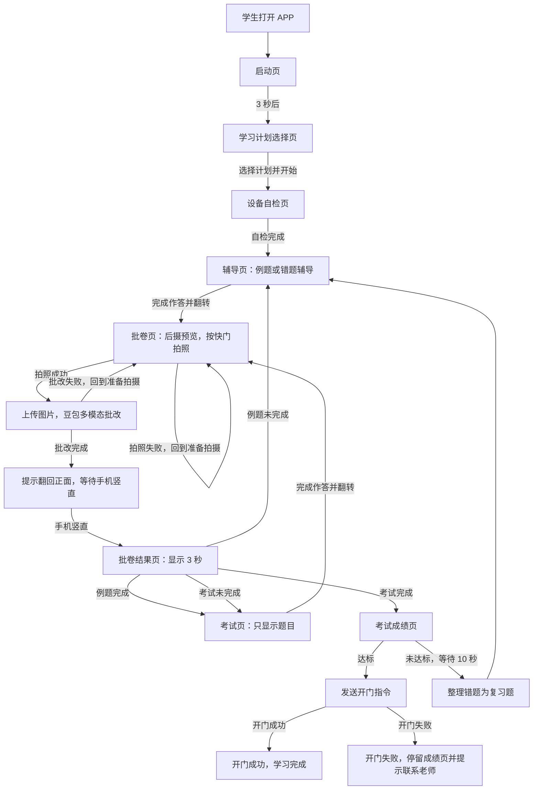

# 使用流程

面向对象：小白用户、外行人、投资人。  
一句话：这是一个“手机锁进学习仓后，靠语音和翻转动作完成学习、判卷、考试，达标后开门”的 Android APP。

## 核心体验

## 关键规则

- 手机锁进仓后，学生不能触摸屏幕。
- 学习计划选择页是唯一主要触控页面。
- 设备自检页之后，只靠语音提示、文字提示、手机翻转推进。
- 辅导页和考试页检测到 `a_z > 7` 稳定 3 秒后进入批卷页。
- 批卷完成后检测到手机竖直，也就是 `|a_z| < 2` 后进入批卷结果页。
- 每道考试题满分为 `100 / 本轮考试题目数量`，考试总分为各题得分相加，不取平均分；100 分是整轮总分，不是单题分数。
- 例题不计入总分，单题满分沿用同一档（`100 / 本轮考试题目数量`）。
- 考试中未拿到本题满分的题视为错题，会整理成复习题回到辅导页；错题辅导完成后只重考这些错题。
- 考试页只显示题目，不显示讲解和答案。
- 可同时选择多个学习计划：按顺序逐个进行，每个计划各自走完「例题 → 考试 → 成绩」，按自己的 `passScore` 判定；达标后 3 秒进入下一个计划，最后一份计划达标才开门。
- 成绩页按计划逐行列出已完成计划的得分与达标状态。
- 批卷页显示后置摄像头预览，由学生按下快门拍照，再上传给豆包多模态批改；整页只有快门一个可点区域。
- 批卷完成后，APP 语音和文字提示学生把手机翻回正面。
- 批卷结果页停留 3 秒后自动进入下一步。
- 考试成绩页按学习计划 `passScore` 判断达标；总分达到 `passScore` 时发送开门指令，未达到时 10 秒后进入错题辅导。
- 当前没有真实开门硬件配置时，开门服务会返回失败并停留在考试成绩页显示提示。
- 异常只在当前页面显示提示层，不单独做异常页。

## MVP 边界

- 先只做 Android。
- 先固定一种 USB 手机仓硬件。
- 先固定一套题目流程：例题讲解、考试、不达标后错题转例题。
- 先跑通完整闭环，再扩展防作弊、门磁反馈、复杂后台。
